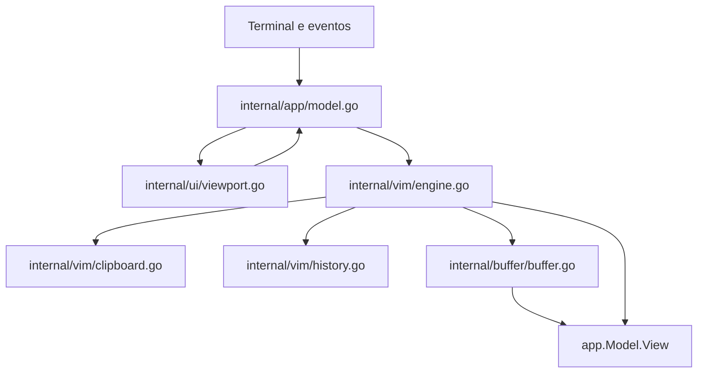

# Especificação Técnica: F09. Seleção com mouse e transferência de texto

## 1. Visão Geral Técnica

A F09 acrescenta seleção por arraste no viewport e transferência de texto simples entre o `mdn` e outros programas. A seleção usa coordenadas lógicas do buffer, mesmo com gutter, rolagem e quebra visual; a cópia serializa os caracteres Markdown originais. A colagem insere na posição do cursor, substitui o intervalo selecionado ou insere na posição de um clique direito sem seleção, sempre como uma única mutação e um único checkpoint de desfazer.

**Escopo incluído:** botão primário (pressionar, arrastar e soltar), destaque persistente até cópia/cancelamento, clique direito para copiar a seleção ativa ou colar sem seleção, cópia com evento `Ctrl+C` ou equivalente encaminhado pelo terminal, colagem em INSERT ou sobre seleção ativa, colagem contextual em NORMAL ou INSERT, colagem delimitada pelo terminal, limites de 10.000 runes Unicode e 200 linhas, mensagens de erro e preservação de terminações lógicas. O evento de paste tem precedência sobre a interpretação de teclas Vim.

**Fora do escopo:** imagens, HTML e outros formatos ricos; seleção controlada exclusivamente pelo emulador de terminal; reconhecimento de `Cmd` quando o terminal não o encaminha ao processo; edição durante COMMAND, SEARCH ou painel de configuração. O terminal deve encaminhar `Cmd+C` como evento equivalente a `Ctrl+C`, e `Cmd+V` como paste delimitado ou atalho equivalente, para que o editor possa tratá-los.

**Contratos consumidos do PRD:** F01 fornece `buffer.Line.Runes`, `Line.Ending`, `Cursor` e `IsDirty`; F03 fornece `ModalState.Selection`, modo, área de transferência e `History`; F07 fornece linhas visíveis, rolagem, gutter e mapeamento de célula de tela para posição lógica. As saídas de F09 são seleção visual, texto simples na área de transferência e buffer atualizado após colagem. Não há API de rede nem persistência própria; o salvamento continua com F01.

## 2. Impacto na Arquitetura

O ponto de entrada mantém `tea.WithAltScreen()` e `tea.WithMouseCellMotion()`. O `app.Model.Update` roteia eventos de mouse e teclado conforme o estado modal; o motor Vim executa cópia e colagem; o buffer faz a substituição transacional; o viewport traduz coordenadas e desenha o destaque existente. Bubble Tea está fixado em **v0.26.6** em `go.mod` e `go.sum`; nessa versão, bracketed paste chega como `tea.KeyMsg` com `Paste == true`. A feature permanece na linha v0/v1, sem migração para Bubble Tea v2.

**Fluxo de mouse:** `MouseButtonLeft` com `MouseActionPress` dentro da área do documento (inclusive gutter) inicia o arraste; eventos `MouseActionMotion` enquanto o botão está pressionado atualizam a ponta da seleção; `MouseActionRelease` encerra o arraste sem apagá-la. `MouseButtonRight` com `MouseActionPress` na área do documento copia uma seleção ativa, independentemente da célula clicada. Sem seleção, cola o clipboard na posição clicada em NORMAL ou INSERT, inclusive quando o clique cai sobre texto; uma célula após o texto aponta para o fim da linha. Na área vazia abaixo da última linha do documento, o ponto de inserção é o fim do documento. A seleção tem prioridade sobre a colagem. Release do botão direito não repete a ação. Eventos de roda conservam a rolagem atual. Mouse sobre o modal ou em COMMAND/SEARCH não modifica o documento; a barra de status e a linha de comando não entram na seleção nem na colagem.

**Fluxo de colagem:** `KeyMsg.Paste` com texto delimitado tem prioridade sobre atalhos e modos, exceto quando modal, COMMAND ou SEARCH estão ativos, casos em que não altera o documento. Em INSERT, `Ctrl+V` consulta a área de transferência; em NORMAL sem seleção preserva Visual Block; com seleção ativa substitui o intervalo. Um clique direito sem seleção consulta o clipboard e insere em NORMAL ou INSERT na coordenada clicada. A entrada validada vira uma única operação de substituição no buffer. O caminho de paste não chama `HandleKey` por caractere e nunca executa `Esc`, `:`, `dd` ou outros comandos contidos no texto.

**Fidelidade visual:** `ui.VisualLine` contém `LogicalLine`, `StartCol` e `EndCol` em índices de runes. `WrapLogicalLine`, `LogicalToVisual` e `MouseToCursor` usam largura de células via `go-runewidth`, sem dividir runes de largura 2 entre segmentos. `MouseToPasteCursor` reutiliza esse mapeamento e, somente para a colagem contextual, converte linhas vazias do viewport abaixo do documento para seu fim. O destaque usa `theme.Selection` e as posições brutas; `word_wrap` muda só a projeção visual, nunca o conteúdo copiado.

## 3. Decisões Técnicas e Premissas

| Decisão | Abordagem escolhida | Alternativa | Consequência |
|---|---|---|---|
| Tecnologia primária | Go 1.27, Bubble Tea v0/v1, Lipgloss e `go-runewidth` existentes | Migrar o TUI inteiro para Bubble Tea v2 | Mantém o padrão TEA e limita a mudança de dependência. |
| Colagem delimitada | Usar Bubble Tea v0.26.6 e tratar `KeyMsg.Paste` antes de `HandleKey` | Parser ANSI próprio sobre o TTY | Evita duplicar o parser de entrada e mantém payload multilinha em um evento. |
| Seleção | Reutilizar `vim.Selection` no modo `ModeVisualChar`, com estado transitório de arraste no `app.Model` | Seleção paralela no pacote `app` | Preserva o renderizador e os comandos visuais existentes. |
| Clique direito | Seleção ativa chama `CopySelection`; sem seleção, `MouseToPasteCursor` e `PasteClipboardAt` colam na posição clicada | Depender do menu de contexto do terminal | Reutiliza a validação e o histórico de F09; o terminal precisa encaminhar o evento de mouse. |
| Célula para rune | Converter com segmentos do viewport e largura de exibição (`runewidth`), compartilhando o cálculo com a renderização | Somar `MouseMsg.X` diretamente a `StartCol` | Exige ajustar funções de quebra visual existentes, mas evita erro com caracteres largos. |
| Clipboard | Adicionar leitura/escrita estrita com erro e provedor injetável, preservando o registrador de fallback dos comandos Vim existentes | Reutilizar `Set/Get`, que ocultam falhas do SO | O atalho novo informa falhas corretamente sem mudar silenciosamente a semântica de `yy` e `p`. |
| Undo de paste | Fechar checkpoint de digitação pendente, aplicar substituição inteira e registrar um checkpoint final | Inserir rune a rune | Uma chamada de `u` remove só a colagem; nenhuma falha pode deixar texto parcial. |

**Premissas explícitas:**

- `Cmd` não é distinguido diretamente no `tea.KeyMsg` da linha v0/v1. O emulador de terminal deve mapear o atalho para `Ctrl+C`/`Ctrl+V` ou entregar paste delimitado; o editor não promete interceptar uma tecla consumida pelo terminal.
- O clique direito também depende de o terminal ou `tmux` encaminhar eventos de mouse ao processo. A ação ocorre no pressionamento dentro do documento; soltar o botão não a executa novamente.
- Uma seleção com mouse só é considerada copiável após alcançar ao menos um rune ou uma quebra lógica; um clique simples move o cursor e cancela a seleção anterior.
- Os limites do PRD são contados como 10.000 runes Unicode e até 200 linhas lógicas (`número de quebras + 1`). `\r\n`, `\n` e `\r` recebidos são normalizados antes da inserção; as novas linhas adotam a convenção da linha de inserção ou, na ausência dela, a primeira terminação válida do documento, com fallback LF. Linhas preexistentes mantêm sua terminação.
- A cópia de uma seleção entre linhas usa os finais lógicos originais do buffer; não acrescenta `\n` por quebra visual. A seleção de modo Visual por teclado mantém seu comportamento, exceto quando o usuário aciona explicitamente o novo atalho.
- Quando o terminal não oferece bracketed paste, texto recebido em INSERT continua sendo inserido normalmente; a garantia de uma única operação de undo para paste multilinha depende de um evento de paste identificável ou do atalho explícito de colar.
- O clique direito sem seleção é uma exceção explícita à exigência de INSERT para colagem direta: funciona em NORMAL e INSERT, sem mudar de modo. Em COMMAND, SEARCH, painel de configurações ou fora do viewport, não lê nem escreve o clipboard.

## 4. Visão Geral dos Componentes

| Arquivo | Alteração | Responsabilidade |
|---|---|---|
| `go.mod`, `go.sum` | Modificar | Fixar Bubble Tea v0.26.6, que expõe `KeyMsg.Paste`, e suas dependências transitivas. |
| `cmd/mdn/main.go` | Revisar | Manter modo de mouse e confirmar bracketed paste habilitado ao iniciar o programa, inclusive com `WithInput(tty)` no fluxo de pipe. |
| `internal/ui/viewport.go` | Modificar | Oferecer conversão de célula `(X,Y)` para `buffer.Cursor` com gutter, scrollbar, `TopLine`, soft wrap e largura Unicode; mapear a área vazia abaixo do documento para seu fim na colagem contextual. |
| `internal/app/model.go` | Modificar | Manter estado de arraste, rotear o pressionamento direito para cópia ou colagem conforme a seleção, priorizar paste e atalhos, preservar rolagem e modal, sincronizar seleção Vim e mensagens, limpar seleção em reload/redimensionamento quando necessário. |
| `internal/vim/engine.go` | Modificar | Expor `CopySelection`, `PasteText`, `PasteClipboard` e `PasteClipboardAt`; coordenar modo, clipboard, seleção e checkpoints do histórico. |
| `internal/vim/clipboard.go` | Modificar | Leitura/escrita estrita da área de transferência com erro testável, sem eliminar o fallback dos comandos Vim existentes. |
| `internal/buffer/buffer.go` | Modificar | Substituir intervalo de runes, inclusive entre linhas, em uma operação protegida pelo mutex; preservar conteúdo não selecionado, cursor, `IsDirty` e terminações. |
| `internal/ui/viewport_test.go`, `internal/app/model_vim_test.go`, `internal/vim/engine_test.go`, `internal/vim/clipboard_test.go`, `internal/buffer/buffer_test.go` | Ampliar | Verificar coordenadas, inclusive espaço vazio abaixo do documento, rotas de clique esquerdo/direito, cópia/colagem, falhas, undo e integridade do buffer. |

## 5. Contratos de Eventos e Operações

| Entrada | Pré-condição | Resultado esperado |
|---|---|---|
| `tea.MouseMsg` com botão esquerdo e ação Press | Posição dentro do viewport, inclusive gutter; modal fechado | Cursor vai para a posição lógica; inicia âncora de seleção sem alterar `IsDirty`. |
| `tea.MouseMsg` com Motion durante arraste | Âncora ativa | Atualiza `Selection.End` após limitar coordenadas e redesenha destaque. |
| `tea.MouseMsg` com Release | Arraste ativo | Finaliza o arraste; preserva seleção não vazia. |
| `tea.MouseMsg` com botão direito e ação Press | Seleção ativa e clique na área do documento | Copia a seleção bruta, mostra `Texto copiado` e limpa a seleção após sucesso; falha preserva seleção, cursor, buffer e histórico. A célula clicada não muda o trecho copiado. |
| `tea.MouseMsg` com botão direito e ação Press | Sem seleção e clique na área do documento; modo NORMAL ou INSERT | Lê o clipboard estritamente e cola no ponto clicado, mantendo o modo e criando um único passo de undo. Área vazia abaixo do documento usa seu fim. |
| `tea.MouseMsg` com botão direito e ação Release | Qualquer modo | Não repete a cópia ou colagem iniciada no Press. |
| `tea.MouseMsg` com botão direito | Painel aberto, COMMAND, SEARCH ou clique na barra de status/fora do viewport | Ignora o evento sem acessar o clipboard ou alterar o documento. |
| `tea.KeyMsg` `ctrl+c` ou equivalente encaminhado | Seleção não vazia, modal fechado | Copia texto bruto para clipboard; mostra `Texto copiado`; limpa a seleção após sucesso; não sai nem marca dirty. |
| `tea.KeyMsg` `ctrl+c` | Sem seleção | Mantém saída existente com proteção `E37` se dirty. |
| `tea.KeyMsg` `ctrl+v` | INSERT ou seleção ativa, modal fechado | Lê texto simples do clipboard e aplica uma substituição validada. |
| `tea.KeyMsg` com `Paste == true` | INSERT ou seleção ativa, modal fechado | Usa `Runes` do evento, sem reler clipboard e sem processar teclas internas. |
| `tea.KeyMsg` `ctrl+v` | NORMAL sem seleção | Mantém entrada em Visual Block. |
| `tea.KeyMsg` `esc` ou clique simples fora da seleção | Seleção ativa | Cancela seleção sem alterar buffer; `Esc` segue a transição modal pertinente. |

**Operação de substituição:** recebe posição inicial e final em coordenadas de runes, texto normalizado e validações já aprovadas. O fim da seleção Visual Char é inclusivo; a operação converte para limite exclusivo antes de editar. A colagem contextual sem seleção passa o mesmo cursor de clique como início e fim, formando um intervalo vazio. `PasteClipboardAt` aceita NORMAL e INSERT, usa leitura estrita e delega à mesma validação de `PasteText` (UTF-8, 10.000 runes, 200 linhas). `buffer.ReplaceRange` constrói o resultado antes de publicá-lo sob `b.mu.Lock()` e devolve erro sem mutação em entradas inválidas. Em caso de sucesso, atualiza o cursor para após o texto inserido, marca `IsDirty` e registra um único checkpoint pós-operação, fechando antes qualquer digitação pendente em INSERT. Copiar usa leitura sem alterar histórico.

**Erros apresentados ao usuário:**

| Condição | Mensagem | Estado após a falha |
|---|---|---|
| Escrita no clipboard falha | `Não foi possível copiar para a área de transferência` | Seleção, cursor, buffer e dirty preservados. |
| Clipboard vazio ou sem texto | `Área de transferência sem texto para colar` | Nenhuma alteração no buffer, cursor, seleção ou histórico. |
| Leitura do clipboard falha | `Não foi possível ler a área de transferência` | Nenhuma alteração no buffer, cursor, seleção ou histórico. |
| Mais de 10.000 runes ou 200 linhas | `Texto para colar excede 10.000 caracteres ou 200 linhas` | Nenhuma inserção parcial; cursor, seleção e histórico preservados. |
| Payload com UTF-8 inválido | `Texto para colar contém UTF-8 inválido` | Nenhuma alteração; evita substituição silenciosa por U+FFFD. |

Bubble Tea v0.26.6 entrega bracketed paste como `[]rune`, sem os bytes originais. Para não aceitar silenciosamente bytes inválidos já convertidos pelo parser, o caminho de `KeyMsg.Paste` rejeita U+FFFD; por consequência, também rejeita esse caractere quando ele era legítimo no texto colado. A leitura direta do clipboard valida UTF-8 a partir da string recebida.

## 6. Modelo de Dados em Memória

Não há banco de dados, migração ou novo formato de arquivo. `vim.Selection` mantém `Start` e `End` como `Position{Line, Col}` com índice zero; a normalização permite arrastar nos dois sentidos. O modelo do app acrescenta apenas estado transitório de botão pressionado/âncora, sem duplicar o texto selecionado. `ui.VisualLine` permanece a fonte de `LogicalLine`, `StartCol` e `EndCol`; o cálculo de células dentro do segmento converte coluna de tela para limite entre runes. `buffer.Line` conserva `Runes` e `Ending`, e `vim.History` conserva snapshots de até 200 estados.

**Invariantes:** `0 <= Line < LineCount`; `0 <= Col <= Line.Length()` para ponto de inserção; seleção nunca aponta para linha inexistente; um clique em célula ocupada por metade direita de caractere largo escolhe a mesma rune, sem criar posição interna impossível; a coluna do gutter cai na primeira rune da linha e a área após o texto cai no fim da linha. Somente `MouseToPasteCursor` mapeia a área vazia do viewport abaixo do documento para `Cursor{última linha, fim}`; `MouseToCursor` continua rejeitando essas linhas para seleção. Alterações de viewport ou arquivo recarregado invalidam coordenadas transitórias e devem revalidar/cancelar a seleção antes da próxima cópia.

## 7. Estratégia de Testes

Testes Go seguem as regras de `AGENTS.md`: casos em tabela com `t.Run`, `t.Parallel` quando não usam clipboard real, `t.TempDir` para arquivo e `go test -race ./...` para mudanças no buffer. A integração com clipboard usa provedor falso e determinístico; a verificação de atalhos `Cmd` ou cliques direitos consumidos por emuladores fica em teste manual de terminal.

| Arquivo de teste | Funções previstas | Cobertura |
|---|---|---|
| `internal/ui/viewport_test.go` | `TestViewport_MouseToCursor`, `TestViewport_MouseWideRuneAndWrap`, `TestViewport_MouseToPasteCursor` | Gutter, rolagem, limites, caracteres largos, quebra visual e área vazia abaixo do documento. |
| `internal/app/model_vim_test.go` | `TestApp_MouseSelectionLifecycle`, `TestApp_CopyShortcutAndQuitFallback`, `TestApp_PasteRouting`, `TestApp_SettingsBlocksTransfer`, `TestApp_RightClickClipboard` | Eventos TEA, clique direito para copiar/colar, prioridade da seleção, destaque, falhas, modal e proteção de saída. |
| `internal/vim/engine_test.go` | `TestEngine_CopySelection`, `TestEngine_PasteAtomicUndo`, `TestEngine_PasteModesAndLimits`, `TestEngine_PasteClipboardAt` | Seleção, texto literal, modos, colagem no cursor de clique, undo e rejeição sem mutação. |
| `internal/vim/clipboard_test.go` | `TestClipboard_StrictReadWriteErrors` | Falhas de leitura/escrita e ausência de falso sucesso. |
| `internal/buffer/buffer_test.go` | `TestBuffer_ReplaceRangeAndLineEndings` | Substituição inclusiva/exclusiva, CRLF, cursor e dirty. |

Os casos detalhados e a rastreabilidade dos onze critérios F09, dos três critérios de integração F01/F03/F07 e dos quatro erros do PRD estão em `tests.md` (TC01–TC23). A validação inclui `go test ./...`, `go test -race ./...`, `go vet ./...`, `gofmt` nos arquivos Go modificados e ensaio manual em terminal com ambos os botões do mouse e colagem real.
