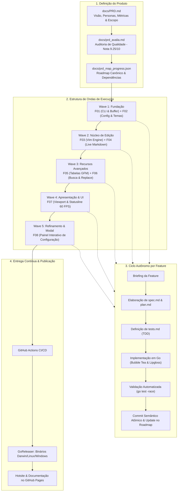

# Como Construímos um Produto de Terminal com PSFDD e Agentes Autônomos de IA: O Caso do md-notes

## Ideia

A ideia partiu de uma necessidade pessoal minha durante o trabalho e a orquestração de **agentes** e **harnesses** de Inteligência Artificial.

Cada vez mais tenho trabalhado diretamente no terminal pelo fato de ser infinitamente mais ágil, leve e consumir muito menos recursos computacionais. No meu dia a dia, venho utilizando mais os *harnesses* de linha de comando como:

- **Antigravity CLI** (`agy`)
- **Agent**
- **Codex**
- **Copilot CLI** / **Claude Code** / **Aider**

Mesmo os aplicativos modernos voltados à engenharia com IA — como *Codex / ChatGPT*, *Cursor* e *Antigravity 2.0* — contam com inicializadores via terminal. Fica extremamente prático fazer edições pontuais simplesmente disparando um comando no terminal para editar um arquivo `.md` ou rascunhar uma nova especificação técnica.

Porém, havia um gargalo constante: **o atrito na alternância de contexto (context switching)**. Toda vez que um agente gerava um plano, PRD ou relatório em Markdown, ou eu abria um editor genérico monocromático que quebrava o alinhamento de tabelas e não dava hierarquia visual, ou precisava abrir um navegador ou IDE pesada só para revisar a formatação. 

Precisávamos de algo novo: um editor de Markdown nativo para terminal (TUI), ultrarrápido (< 50 ms de inicialização), com atalhos e ergonomia do **Vim**, destaque de sintaxe em tempo real não-destrutivo (mantendo os marcadores `#`, `*`, `|` visíveis mas atenuados) e alinhamento inteligente de tabelas. Assim nasceu o **md-notes** (`mdn`).

No universo _Windows_, a ferramenta se torna ainda mais relevante, pois a maioria dos editores de terminal modernos (como *Alacritty*, *Kitty*, *WezTerm*) não possuem suporte nativo a Markdown e comandos *vim*, e o **md-notes** preenche essa lacuna com uma experiência de edição modal e responsiva.

---

## Direcionamento Tecnológico: Por que Go superou Rust neste projeto?

O objetivo técnico era cristalino: uma aplicação de terminal multiplataforma, nativa, sem dependências de runtime externas (Node.js, Python ou bibliotecas C dinâmicas), com navegação e ferramentas de edição modal baseadas no padrão **Vim**. 

No momento da tomada de decisão de arquitetura, duas linguagens despontaram: **Go** e **Rust**. Ambas são excelentes para CLIs modernas e entregam binários compilados de alta performance. No entanto, optamos categoricamente por **Go** pelos seguintes motivos fundamentais:

1. **A Maturidade Inigualável do Ecossistema TUI (Charmbracelet Stack)**:
   Em Go, temos acesso ao ecossistema da [Charmbracelet](https://charm.sh):
   - **Bubble Tea**: Uma implementação elegante e robusta de *The Elm Architecture* (TEA) baseada em um ciclo de vida unidirecional previsível (`Init`, `Update`, `View`).
   - **Lipgloss**: Motor declarativo de estilização com suporte a TrueColor (24-bit ANSI), bordas estilizadas e layouts responsivos.
   Enquanto o ecossistema Rust (como `ratatui`) é competente, a separação limpa de estado e mensagens do Bubble Tea simplificou drasticamente a orquestração reativa de eventos entre o buffer, a máquina de estados do Vim e as rotinas assíncronas.

2. **Compilação Cruzada Trivial e Estática (`CGO_ENABLED=0`)**:
   Em Go, gerar binários estáticos nativos para macOS (`amd64`, `arm64`, Universal Binary via `lipo`), Linux (`amd64`, `arm64`) e Windows é uma questão de variáveis de ambiente (`GOOS` e `GOARCH`), sem necessidade de toolchains complexas de C, containers de build pesados com `cross` ou problemas com bibliotecas de sistema (OpenSSL, libc vs musl).

3. **Invariantes de Performance Atingidas com Menor Complexidade**:
   As metas do produto exigiam:
   - *Cold boot time* < 50 ms (o Go entrega entre 10 e 15 ms).
   - Consumo de memória residente (RSS) < 25 MB.
   - Latência de renderização interativa < 16 ms (garantindo 60 FPS durante digitação contínua e rolagem).
   O compilador e o garbage collector do Go atenderam essas exigências com folga, sem o custo cognitivo do *borrow checker* e sem tempos de compilação lentos que atrasam o feedback loop.

4. **Sinergia Perfeita com Agentes de IA e Concorrência Idiomática**:
   A sintaxe minimalista, a biblioteca padrão ortogonal (`os`, `sync`, `unicode/utf8`) e o modelo de erro explícito do Go (`if err != nil`) geram um nível altíssimo de assertividade para modelos de linguagem. O agente não se perde em abstrações esotéricas de tipos ou lifetimes complexos, produzindo testes de tabela (*table-driven tests*) limpos e código livre de corridas (*data races* via goroutines e canais para watcher de arquivos em background).

> Aqui foi importante ter um conhecimento tecnico de linguagens de programação e suas bibliotecas, para poder tomar uma decisão fundamentada sobre qual linguagem seria mais adequada para o projeto. A escolha de Go se mostrou acertada devido à sua maturidade no ecossistema TUI, facilidade de compilação cruzada, performance consistente e sinergia com agentes de IA.

---

## O Harness Escolhido e o Papel da IA

Para a condução do projeto, o *harness* selecionado foi o **Antigravity CLI** (`agy`), operando em conjunto com o recém-lançado modelo **Gemini 3.8 Flash High**. 

A velocidade de inferência, o raciocínio refinado para refatorações estruturais e a capacidade de manter o contexto das especificações foram impecáveis.

Sem contar seu suporte a _1 milhão de tokens_ de contexto, permitindo que o agente mantivesse a visão completa do PRD, roadmap e histórico de commits sem perder coerência.

Contudo, sejamos transparentes: **o harness e o LLM não foram os fatores determinantes para o sucesso da entrega**. As ferramentas modernas de IA do mercado (Claude Code, Codex, Copilot CLI, Antigravity) hoje operam em patamares muito próximos de qualidade técnica.

Se o harness e o modelo são commodities, **de onde vem o verdadeiro diferencial competitivo?** 

A resposta é inequívoca: **vem do método de engenharia.**

---

## PSFDD: Product & Spec Feature Driven Development

O desenvolvimento assistido por agentes não funciona bem quando alimentado por prompts soltos ou comandos genéricos como *"crie um editor markdown em Go"*. Isso inevitavelmente gera dívida técnica, alucinações de escopo e arquiteturas frágeis.

O tradicional **SDD** (*Spec Driven Development*) evoluiu em nosso fluxo para o **PSFDD** (*Product & Spec Feature Driven Development*):
1. **Começa pelo Produto**: Definimos a visão executiva, personas, problemas, objetivos, critérios quantitativos de sucesso, métricas e o que está expressamente **Fora de Escopo** em um **PRD (Product Requirements Document)** completo.
2. **Avaliação Crítica do PRD**: Antes de uma única linha de código ser escrita, o PRD foi submetido a uma auditoria automática e iterativa de qualidade (avaliando Clareza, Confiabilidade, Legibilidade e Ambiguidade), atingindo a nota **9.25 / 10.0**.
3. **Mapeamento de Features e Grafo de Dependências**: As necessidades de produto são quebradas em recursos atômicos (**F01 a F08**) organizados em **Execution Waves** (ondas sequenciais e paralelas) em um arquivo canônico de roadmap (`prd_map_progress.json`).
4. **Tríade Técnica por Feature**: Nenhuma feature é codificada sem sua tríade:
   - `spec.md` (Arquitetura técnica, contratos de API e interfaces)
   - `plan.md` (Passos atômicos e ordenados de implementação)
   - `tests.md` (Critérios de validação e casos de teste automatizados)
5. **Implementação Guiada por Agentes com Commits Atômicos**: O agente executa fase por fase, validando testes unitários, checando concorrência com `go test -race ./...` e registrando commits semânticos por etapa.

---

## O Fluxo de Desenvolvimento: Da Visão do Produto à Release

Abaixo está a representação visual da jornada PSFDD adotada no `md-notes`, orquestrada entre o desenvolvedor, a base de especificações e o agente de IA:

---

Para conferir em detalhes o funcionamento prático de cada recurso, animações, atalhos do Vim suportados e guias de instalação, acesse a página oficial do projeto:

**[arquitetomovel.github.io/md-notes](https://arquitetomovel.github.io/md-notes/)**

---

## O Impacto Real: Comparativo de Esforço

Para tangibilizar o ganho de eficiência do fluxo PSFDD aliado a agentes autônomos, levantamos as métricas reais com base nas 15 sessões agênticas, 57 commits atômicos, 4 PRs e nas especificações geradas ao longo do projeto:

| Etapa | Estimativa Tradicional Humana | Realizado com PSFDD + Agentes | Ganho / Aceleração |
| :--- | :---: | :---: | :---: |
| **Concepção de PRD, Personas e Avaliação** | 12 a 16 horas | **~15 minutos** | **~50x** |
| **Especificação Técnica (F01 a F08: specs, plans, tests)** | 24 a 32 horas | **~3,1 horas** | **~10x** |
| **Implementação do Editor TUI em Go + Testes** | 60 a 80 horas | **~2,2 horas** | **~30x** |
| **Pipeline de CI/CD, GoReleaser, Hotsite & Docs** | 16 a 24 horas | **~2,4 horas** | **~8x** |
| **TOTAL** | **112 a 152 horas** (~3 a 4 semanas) | **~8 a 10 horas** (em 7 dias) | **~15x de produtividade** |

Um produto de alta complexidade técnica — com editor modal em Go, *The Elm Architecture*, parser Markdown em tempo real, tabelas dinâmicas com Unicode, busca regex, painel modal interativo e releases multiplataforma compiladas — foi entregue do zero à produção com **menos de 10 horas de trabalho ativo** humano-agêntico e zero dívida técnica.

---

## Lições Aprendidas sobre a Engenharia de Software com Agentes

Construir o **md-notes** com agentes autônomos trouxe três aprendizados definitivos:

1. **Agentes sem especificação constroem castelos de areia na velocidade da luz**: Se você pedir código diretamente, o agente gerará soluções incompletas, cheias de bugs sutis e sem coesão. Com o **PSFDD**, cada feature nasce de um contrato imutável e verificável. O agente tem guardrails claros.
2. **O valor inegociável do TDD e dos Commits Atômicos**: Cada etapa do plano foi acompanhada de seus testes. Se um teste de corrida de concorrência ou redimensionamento de terminal falhasse, o agente diagnosticava e corrigia o problema antes de avançar para a próxima feature.
3. **A simplicidade da stack potencializa a IA**: Escolher Go, Bubble Tea e uma arquitetura baseada no The Elm Architecture reduziu ruídos conceituais a quase zero. Sistemas modulares e com responsabilidades bem isoladas são o playground onde a inteligência artificial performa no seu nível máximo.

---

O **md-notes** (`mdn`) é hoje um binário nativo, estável, multiplataforma e com hotsite disponível. Mais do que uma ferramenta indispensável no meu próprio terminal de desenvolvimento, ele serviu como prova cabal de que a engenharia de software na era da IA não substitui o rigor metodológico — ela o torna exponencial.

E você, já experimentou estruturar o desenvolvimento com agentes através de especificações orientadas a produto (PSFDD)? Como tem sido sua experiência integrando ferramentas de terminal com fluxos agenticos? Vamos debater nos comentários!

---

### Tags & Palavras-chave

#EngenhariaDeSoftware #Golang #InteligenciaArtificial #AIAgents #AgentesDeIA #SpecDrivenDevelopment #PSFDD #AntigravityCLI #Gemini #BubbleTea #TUI #Terminal #Vim #DevOps #Produtividade #OpenSource #SoftwareArchitecture #ProductManagement #LLM
